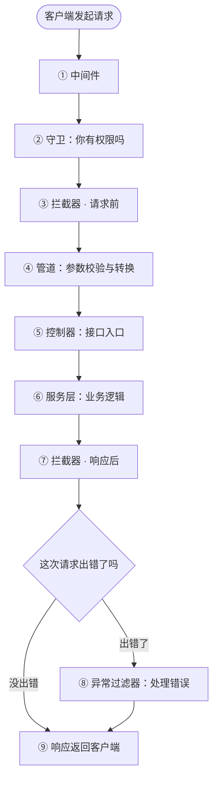
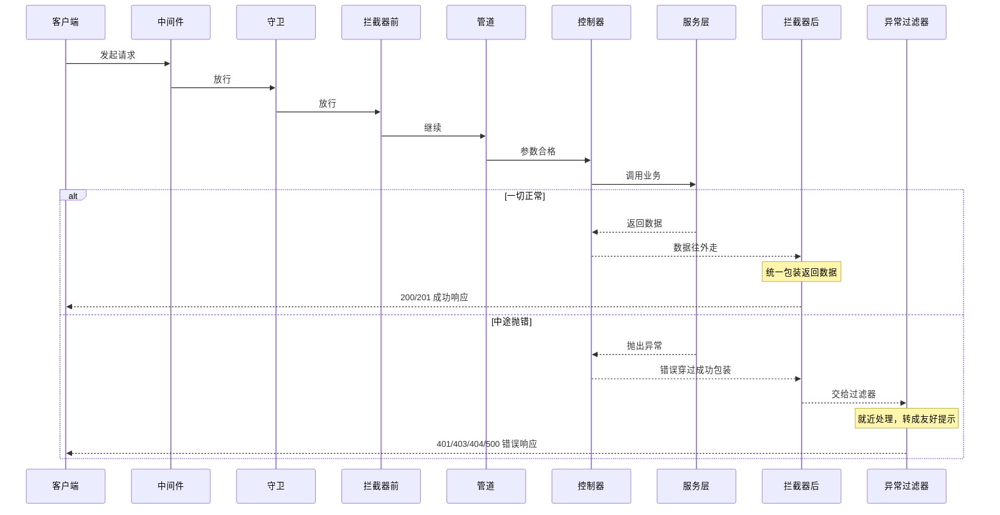

# NestJS 请求生命周期

这个项目把一次请求在 NestJS 里经过的所有环节——**中间件、守卫、拦截器、管道、异常过滤器**——都写了可运行的代码，业务场景是常见的「博客文章接口」：登录、权限、限流、参数校验、统一返回格式、报错处理、超时保护。

每个环节都会打印带编号的日志，**发一次请求，就能在终端按顺序看到它完整的"旅行路线"**。

---

## 一、先用你熟悉的前端概念认识它们

如果你写过 Vue / React，下面的类比能帮你秒懂：

| NestJS 里的名字 | 前端里类似的东西 | 它负责什么 |
|---|---|---|
| **中间件 Middleware** | Express/Koa 中间件、Axios 的请求拦截器 | 请求到达业务代码前的第一道处理，比如记日志 |
| **守卫 Guard** | Vue Router 的 `router.beforeEach` 导航守卫、React 路由保护 | 判断"你有没有资格调这个接口"（登录了吗、是管理员吗） |
| **拦截器 Interceptor** | Axios 的「请求拦截器 + 响应拦截器」 | 在方法执行**前**和返回**后**都能插一脚，比如计时、包装返回数据 |
| **管道 Pipe** | 表单校验规则 + 提交前的数据格式化（trim、转数字） | 校验参数合不合法、把参数转换成想要的类型 |
| **控制器 Controller** | 路由表里绑定的处理函数（接口入口） | 接收请求、调用业务代码、返回结果 |
| **服务层 Service** | 前端的 `api/`、`service/` 层 | 真正干活的地方：查数据库、写业务逻辑 |
| **异常过滤器 Exception Filter** | Axios 响应拦截器里的错误处理、React 的 ErrorBoundary | 出了错，把它变成一段友好的提示返回给前端 |
| **DTO** | 提交表单时约定的数据结构（TypeScript 接口 + 校验规则） | 描述"这个接口应该收到什么字段" |

> 两个高频英文词，先记住：
> - **pre（请求前）**：控制器方法执行**之前**运行的拦截逻辑
> - **post（响应后）**：控制器方法执行**之后、返回给前端之前**运行的拦截逻辑

打个生活比方（坐飞机）：中间件像进航站楼时的登记，守卫像安检和验票（没票不让进），管道像核对登机牌信息格式，控制器是你坐到座位，服务层是飞机把你送到目的地，拦截器在起飞前/降落后各忙一次，而异常过滤器就是"航班出问题时才出现"的应急柜台。

---

## 二、一张图看懂完整路线

> 下面是**纯文本图**，任何 Markdown 预览器都能正常显示；后面再附一张 Mermaid 彩色图（预览器支持时会更好看）。

```text
客户端
  │  发起一个 HTTP 请求
  ▼
─────────────────────── 请求往里走（去程） ───────────────────────
  ① 中间件 Middleware         顺序：全局中间件 → 模块中间件
  ② 守卫 Guard                顺序：全局守卫 → 控制器守卫 → 路由守卫
  ③ 拦截器（请求前 pre）       顺序：全局 → 控制器 → 路由
  ④ 管道 Pipe                 顺序：全局 → 控制器 → 路由 → 参数管道
  ⑤ 控制器 Controller         执行对应的接口方法
  ⑥ 服务层 Service            执行业务逻辑、读写数据库
─────────────────────── 结果往外走（回程） ───────────────────────
  ⑦ 拦截器（响应后 post）      顺序反过来：路由 → 控制器 → 全局
  │
  ├── 一切正常：直接往下
  │
  └── 中途抛错了：
        ⑧ 异常过滤器          顺序：路由过滤器 → 控制器过滤器 → 全局过滤器
  │
  ▼
  ⑨ 响应返回给客户端
```

Mermaid 版本（如果你的预览器支持渲染）：



记住两条路：

- **去程（请求进入）**：中间件 → 守卫 → 拦截器(请求前) → 管道 → 控制器 → 服务层
- **回程（结果返回）**：服务层 → 拦截器(响应后) →（出错时）异常过滤器 → 客户端

---

## 三、逐层拆解（每一层到底干嘛）

### ① 中间件 Middleware —— 大门保安 + 前台登记

- **是什么**：请求进入框架后最先经过的一层，能拿到最原始的请求和响应对象。
- **前端类比**：Express 中间件、Axios 请求拦截器。
- **本项目例子**：
  - 全局 `LoggerMiddleware`：记录"什么时间、谁、请求了哪个接口"，并开始计时；
  - 模块 `RequestIdMiddleware`：给每个请求生成一个唯一编号 `requestId`，放进响应头，方便以后排查问题。
- **不通过会怎样**：中间件里不调用 `next()`，请求就会卡住（所以正常逻辑最后一定要 `next()`）。

### ② 守卫 Guard —— 你能进这个接口吗

- **是什么**：专门做"准入判断"，返回 `true` 放行，返回 `false` 或抛异常就拒绝。
- **前端类比**：Vue Router 的 `router.beforeEach`，没登录就跳转登录页；这里是没登录直接返回 401。
- **本项目例子**：
  - 全局 `AuthGuard`：检查请求头里的登录凭证（模拟 JWT），没登录 → **401**；
  - 控制器 `RolesGuard`：检查角色，普通用户调管理员接口 → **403**；
  - 路由 `ThrottleGuard`：接口限流，1 分钟超过 5 次 → **429**。
- **关键点**：守卫在拦截器和管道**之前**执行，所以没登录的请求会在很前面就被拦下，根本走不到参数校验。

### ③ 拦截器（请求前 pre） —— 方法执行前先做点事

- **是什么**：拦截器包裹着控制器方法，在方法执行前（pre）和返回后（post）各有一段逻辑。
- **前端类比**：Axios 拦截器——请求发出去之前改配置，响应回来之后先统一处理。
- **本项目例子**：`LoggingInterceptor` 在请求前记录"请求来了"；`AuditInterceptor` 记录"谁要操作文章模块"。
- **特别注意（洋葱模型）**：拦截器像洋葱一样一层层包裹。请求前按注册顺序"由外到内"执行，响应后按**相反顺序**"由内到外"执行。例如全局注册顺序是 `日志拦截器 → 数据包装拦截器`，那么响应后是"数据包装"先干活、"日志"最后收尾。

### ④ 管道 Pipe —— 参数体检 + 格式化

- **是什么**：在参数即将交给控制器方法前，对参数做**校验**和**转换**。
- **前端类比**：表单提交前的校验规则（必填、最小长度）+ 数据格式化（`trim()`、字符串转数字）。
- **本项目例子**：
  - 全局 `ValidationPipe`：按 DTO 规则自动校验请求体，标题太短 → **400**，并自动剔除多余字段；
  - 路由 `RouteLevelPipe`：把标题两端空格 `trim()` 掉；
  - 参数 `ParseIntPipe` + `PositiveIntPipe`：把地址里的 id 转成整数，并检查必须是正数。
- **关键点**：管道只负责"参数对不对、长什么样"，**不要**在这里写业务逻辑或权限判断。

### ⑤ 控制器 Controller —— 接口入口

- **是什么**：路由真正匹配到的方法，负责接收已经处理好的参数、调用服务层、把结果交出去。
- **前端类比**：路由表里每个路径绑定的处理函数。
- **本项目例子**：`ArticleController` 里的增删改查方法。

### ⑥ 服务层 Service —— 真正干活的人

- **是什么**：业务逻辑和数据库操作都放这里，控制器只负责"调度"它。
- **前端类比**：前端项目里的 `api/`、`service/` 层。
- **本项目例子**：`ArticleService` 用内存数组模拟数据库，提供创建、查询；查不到文章时抛出"未找到"异常。

### ⑦ 拦截器（响应后 post） —— 结果出门前的统一处理

- **是什么**：控制器方法执行完、结果返回前的处理逻辑。
- **本项目例子**：
  - `TransformInterceptor`：把返回数据统一包装成 `{ code: 0, message: "success", data: ... }`；
  - `LoggingInterceptor`：记录本次请求总耗时。
- **关键点**：如果中途抛错，错误会**绕过**这里的成功包装（`map`），所以错误响应不会被包成 `code: 0`。

### ⑧ 异常过滤器 Exception Filter —— 出错时的应急柜台

- **是什么**：**只有抛异常时才会运行**，负责把错误转换成一段结构化的提示返回给前端。
- **前端类比**：Axios 响应拦截器里的 `catch` 统一弹错误提示、React 的 ErrorBoundary。
- **本项目例子**：
  - 路由过滤器：离错误最近，优先处理该路由的错误；
  - 控制器过滤器：只处理"业务异常"，其他错误继续往上抛；
  - 全局过滤器：兜底所有错误（包括程序自身的 bug → 500）。
- **关键点（就近原则）**：路由级 → 控制器级 → 全局级，谁先匹配谁处理；处理不了可以重新抛出，交给更外层。

### ⑨ 响应 —— 回到客户端

结果（成功数据包或错误提示）通过 HTTP 响应发回给前端，本次请求结束。

---

## 四、正常 vs 报错：两条回程路线



文字总结：

- **正常情况**：服务层返回数据 → 拦截器(响应后)按洋葱反序执行（包装数据、记耗时）→ 客户端收到成功响应。
- **报错情况**：任意一层抛出异常 → 错误绕过成功包装 → 异常过滤器按"路由 → 控制器 → 全局"就近处理 → 客户端收到带错误码和提示的响应。

---

## 五、本项目组件对照表

| 阶段 | 作用范围 | 类名 | 文件位置 | 职责 |
|---|---|---|---|---|
| ① 中间件 | 全局 | `LoggerMiddleware` | `src/common/middleware/logger.middleware.ts` | 访问日志、请求计时 |
| ① 中间件 | 模块 | `RequestIdMiddleware` | `src/common/middleware/request-id.middleware.ts` | 生成 requestId |
| ② 守卫 | 全局 | `AuthGuard` | `src/common/guards/auth.guard.ts` | 登录认证，失败 401 |
| ② 守卫 | 控制器 | `RolesGuard` | `src/common/guards/roles.guard.ts` | 角色鉴权，失败 403 |
| ② 守卫 | 路由 | `ThrottleGuard` | `src/common/guards/throttle.guard.ts` | 接口限流，超限 429 |
| ③⑦ 拦截器 | 全局 | `LoggingInterceptor` | `src/common/interceptors/logging.interceptor.ts` | 请求前/响应后日志与耗时 |
| ⑦ 拦截器 | 全局 | `TransformInterceptor` | `src/common/interceptors/transform.interceptor.ts` | 统一成功响应格式 |
| ③⑦ 拦截器 | 控制器 | `AuditInterceptor` | `src/common/interceptors/audit.interceptor.ts` | 操作审计 |
| ③⑦ 拦截器 | 路由 | `TimeoutInterceptor` | `src/common/interceptors/timeout.interceptor.ts` | 超时保护，超时 408 |
| ④ 管道 | 全局 | `ValidationPipe`（内置） | `src/main.ts` | DTO 校验与转换 |
| ④ 管道 | 控制器 | `ControllerLevelPipe` | `src/common/pipes/controller-level.pipe.ts` | 控制器级管道演示 |
| ④ 管道 | 路由 | `RouteLevelPipe` | `src/common/pipes/route-level.pipe.ts` | 标题 trim |
| ④ 管道 | 参数 | `ParseIntPipe`（内置）、`PositiveIntPipe` | `src/common/pipes/positive-int.pipe.ts` | id 转整数并校验正数 |
| ⑧ 过滤器 | 路由 | `RouteExceptionFilter` | `src/common/filters/route-exception.filter.ts` | 路由级错误处理 |
| ⑧ 过滤器 | 控制器 | `ControllerExceptionFilter` | `src/common/filters/controller-exception.filter.ts` | 业务异常处理，其余透传 |
| ⑧ 过滤器 | 全局 | `GlobalHttpFilter` | `src/common/filters/global-http.filter.ts` | 全局兜底 |

---

## 六、项目目录结构

```text
nest-lifecycle-demo/
├── package.json              # 依赖与启动脚本
├── tsconfig.json             # TypeScript 配置
├── nest-cli.json
└── src/
    ├── main.ts               # 启动入口：注册全局守卫/拦截器/管道/过滤器
    ├── app.module.ts         # 根模块：注册全局中间件
    ├── common/               # 通用能力
    │   ├── flow-logger.ts    # 统一的生命周期日志工具
    │   ├── types.ts          # 请求对象、用户对象的类型
    │   ├── decorators/       # 自定义装饰器：@Public()、@Roles()
    │   ├── middleware/       # 中间件
    │   ├── guards/           # 守卫
    │   ├── interceptors/     # 拦截器
    │   ├── pipes/            # 管道
    │   ├── filters/          # 异常过滤器
    │   └── exceptions/       # 自定义业务异常
    └── modules/
        └── article/          # 文章业务模块（控制器/服务/DTO）
```

---

## 七、如何运行

```bash
# 进入项目目录
cd E:\zxy\test\nest-lifecycle-demo

# 安装依赖（本机已配置国内镜像，已安装过可跳过）
npm install

# 开发模式直接运行
npm run dev

# 或者编译后运行
npm run build
npm start
```

启动成功后访问：`http://localhost:3000`。

本项目用两个写死的 token 模拟登录（无需真实签发）：

| 请求头里携带的 token | 对应身份 | 角色 |
|---|---|---|
| `admin-token` | admin | 管理员 |
| `user-token` | reader | 普通用户 |

---

## 八、动手测试清单（复制即用）

> Windows PowerShell 里中文可能显示成乱码，那只是控制台编码问题，实际返回是正常的 UTF-8，建议用 Postman/Apifox 或下面的 curl 测试。

**1. 正常请求（观察终端完整流转）**

```bash
curl http://localhost:3000/articles/1
curl "http://localhost:3000/articles?page=1&pageSize=10"
```

**2. 守卫：401 / 403 / 429**

```bash
# 没带 token → 401
curl -X POST http://localhost:3000/articles -H "Content-Type: application/json" -d "{\"title\":\"测试文章\",\"content\":\"内容\"}"

# 普通用户 → 403
curl -X POST http://localhost:3000/articles -H "Authorization: Bearer user-token" -H "Content-Type: application/json" -d "{\"title\":\"测试文章\",\"content\":\"内容\"}"

# 管理员 → 201 成功（短时间内连续调超过 5 次会变 429）
curl -X POST http://localhost:3000/articles -H "Authorization: Bearer admin-token" -H "Content-Type: application/json" -d "{\"title\":\"测试文章\",\"content\":\"内容\",\"tags\":[\"node\"]}"
```

**3. 管道：参数校验**

```bash
curl -X POST http://localhost:3000/articles -H "Authorization: Bearer admin-token" -H "Content-Type: application/json" -d "{\"title\":\"x\",\"content\":\"内容\"}"   # 标题太短 → 400
curl http://localhost:3000/articles/abc    # id 不是数字 → 400
curl http://localhost:3000/articles/-5     # id 不是正数 → 400
```

**4. 异常过滤器三层对比**

```bash
curl http://localhost:3000/articles/demo/route-error       # 路由过滤器处理
curl http://localhost:3000/articles/demo/controller-error # 控制器过滤器处理
curl http://localhost:3000/articles/999                   # 全局过滤器兜底（404）
```

**5. 超时拦截器**

```bash
curl http://localhost:3000/articles/slow   # 服务要 4 秒，3 秒就被中断 → 408
```

---

## 九、一次真实请求打印的日志

请求 `GET /articles/1`，终端输出如下（注意响应后的顺序是反过来的）：

```text
01:38:43.573 | 1-Middleware         | Global     | LoggerMiddleware 收到请求 GET /articles/1
01:38:43.574 | 1-Middleware         | Module     | RequestIdMiddleware 注入 requestId=53094ec0-...
01:38:43.575 | 2-Guard              | Global     | AuthGuard 命中 @Public()，放行
01:38:43.575 | 2-Guard              | Controller | RolesGuard 该路由未声明角色要求，放行
01:38:43.577 | 3-Interceptor-pre    | Global     | LoggingInterceptor 请求前
01:38:43.577 | 3-Interceptor-pre    | Global     | TransformInterceptor 请求前
01:38:43.578 | 3-Interceptor-pre    | Controller | AuditInterceptor 审计开始
01:38:43.579 | 4-Pipe               | Controller | ControllerLevelPipe 处理参数
01:38:43.579 | 4-Pipe               | Param      | PositiveIntPipe 校验 id="1"
01:38:43.579 | 5-Controller         | Route      | 执行 findOne() id=1
01:38:43.579 | 6-Service            | -          | ArticleService.findOne id=1
01:38:43.579 | 7-Interceptor-post   | Controller | AuditInterceptor 响应后，耗时=1ms
01:38:43.579 | 7-Interceptor-post   | Global     | TransformInterceptor 包装统一响应体
01:38:43.579 | 7-Interceptor-post   | Global     | LoggingInterceptor 响应后，耗时=2ms
01:38:43.584 | 9-Response           | Global     | 响应已返回 status=200，总耗时=11ms
```

日志中的 `Global / Controller / Route / Module / Param` 表示该组件的**注册作用范围**（全局 / 控制器级 / 路由级 / 模块级 / 参数级），不是缩写黑话。

---

## 十、新手常见疑问

**Q1：为什么全局组件在 `main.ts` 里是 `new` 出来的？**
这样写最简单，但 `new` 出来的实例不归 Nest 的依赖注入容器管，里面无法注入别的服务。
如果全局组件需要注入服务，改成在模块里用令牌注册：

```typescript
import { APP_GUARD, APP_INTERCEPTOR, APP_PIPE, APP_FILTER } from '@nestjs/core';

@Module({
  providers: [
    { provide: APP_GUARD, useClass: AuthGuard },
    { provide: APP_INTERCEPTOR, useClass: LoggingInterceptor },
    { provide: APP_PIPE, useClass: ValidationPipe },
    { provide: APP_FILTER, useClass: GlobalHttpFilter },
  ],
})
export class AppModule {}
```

**Q2：为什么没有"注册全局中间件"的方法？**
Nest 没有提供 `useGlobalMiddleware`。全局中间件的标准做法是在根模块的 `configure()` 里用 `forRoutes('*')` 注册；也可以在 `main.ts` 直接 `app.use(...)`（等价于原生 Express 中间件）。

**Q3：为什么静态路径要写在 `:id` 前面？**
路由按注册顺序匹配。如果 `@Get(':id')` 写在前面，请求 `/articles/demo/route-error` 会被当成 `id = "demo"`，然后被数字转换管道判为 400，演示方法就永远进不去了。

**Q4：拦截器和过滤器都能处理错误，怎么分工？**
- 拦截器：处理和"这次方法调用"绑定的横切逻辑，比如超时、重试、缓存、日志、数据包装（基于 RxJS 数据流）；
- 过滤器：把异常"翻译"成 HTTP 响应（状态码、错误提示结构），是错误处理的终点。
- 两者配合：拦截器负责制造/转换异常（如超时拦截器抛出超时错误），过滤器负责把它变成友好响应。

**Q5：pre 和 post 还是有点晕？**
记住拦截器就是 Axios 那对拦截器：**pre = 请求拦截器（方法执行前），post = 响应拦截器（方法执行后）**，只是 post 阶段在后端还没真正发给前端，所以还能修改返回内容。
